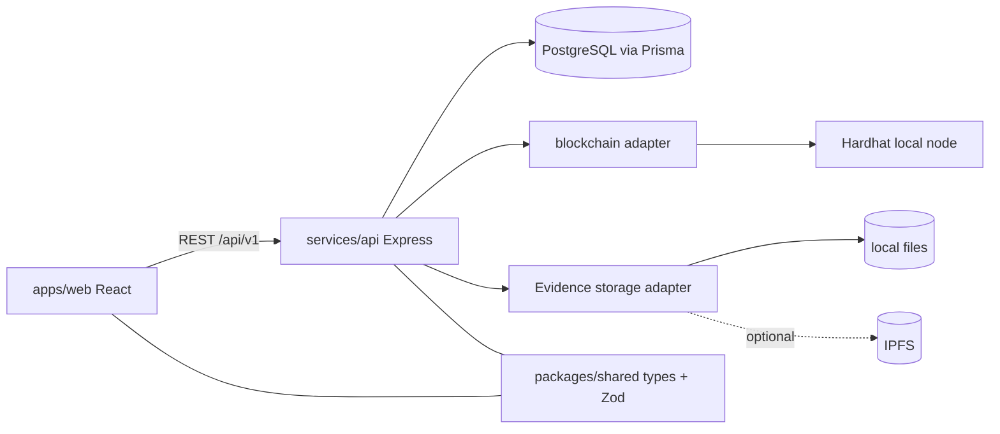

# Architecture (initial)

Responsibilities
- **apps/web** — UI only; no business rules duplicated from the server.
- **services/api** — authentication, RBAC, mass-balance logic, lineage, recalls, audit.
- **blockchain** — minimal on-chain state: batch IDs, quantities in grams, status, evidence hashes. No personal or commercial data.
- **prisma** — private detail data, lineage, operations, audit.
- **packages/shared** — Zod schemas and types used by both web and API.

Database and chain are separate systems; consistency strategy (pending state, retry, reconciliation) is planned for Phase 7.
