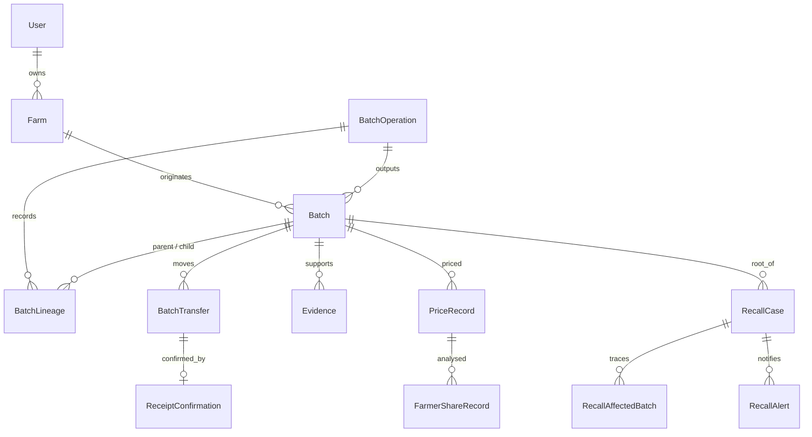

# Database (PostgreSQL 16 + Prisma 6)

Status: schema, integrity SQL, seed and scripts are written. **None have been executed yet** (no Docker/Postgres/npm access in the authoring sandbox). Results from your machine should be added to `docs/implementation-status.md`.

## Design rules
- Quantities are **integer grams** (`Int`, max ~2,147 tonnes per batch). No `Float` anywhere.
- Money is `Decimal(14,2)` with a 3-letter currency code. `FarmerShareRecord.costBreakdown` is JSON; store amounts as strings.
- Batches are never deleted; consumed batches keep their quantity and get status `CONSUMED`.
- `BatchOperation.idempotencyKey`, `BatchTransfer.idempotencyKey`, `Batch.idempotencyKey` are unique (replay protection). `Batch.version` supports optimistic concurrency.
- `ReceiptConfirmation.transferId` is unique: one confirmation per transfer.
- Not modelled yet: sessions/refresh tokens and anomaly records (added with the auth and anomaly modules).
- `Batch.currentQuantityGrams` is kept equal to the initial quantity for consumed batches (historical record); use `status` to know whether it is available.

## First-time setup
```bash
cp .env.example .env
npm install
npm run db:up                      # PostgreSQL in Docker; wait until healthy
docker compose ps                  # STATUS should say "healthy"
npm run db:migrate -- --name init  # creates + applies the initial migration, generates the client
```

### Integrity migration (CHECK constraints + append-only AuditLog)
Prisma cannot express these, so add them as a second migration:
```bash
npm run db:migrate -- --create-only --name integrity_checks
# paste the contents of prisma/sql/integrity_checks.sql into the new
# prisma/migrations/<timestamp>_integrity_checks/migration.sql, then:
npm run db:migrate
```
They enforce: positive/bounded batch quantities, `input = outputs + loss` for non-registration operations, positive lineage grams, no self-parent, sender != recipient, SHA-256 hex format, certification must reference a farm or batch, and a trigger that rejects UPDATE/DELETE on `AuditLog`.

Commit the generated `prisma/migrations/` folder.

## Seed (fictional demo data)
```bash
npm run db:seed
```
- Refuses to run if `NODE_ENV=production`, if the database host is not local, or if users already exist (nothing is changed in that case).
- Creates 8 demo users (`*@demo.agritrace.test`, password from `SEED_DEMO_PASSWORD`, development only), 2 farms, 7 batches, 3 transformations, transfers with receipts, evidence metadata, certifications, prices, a sample recall, alerts, and audit entries.
- Consistent scenario (grams): B1 1,000,000 → B2 600,000 + B3 380,000 + loss 20,000; B2 → B4 400,000 + B5 195,000 + loss 5,000; B3 380,000 + B6 300,000 → B7 680,000.
- Ends by running the consistency verifier; the seed exits non-zero if any invariant fails.

## Verify and health
```bash
npm run db:health     # SELECT 1 + table count; exit 1 if unreachable
npm run db:verify     # re-checks mass balance and lineage from stored data
npm run db:typecheck  # type-checks the seed/health scripts
```
An HTTP `/health` endpoint will reuse the same `SELECT 1` check when the API exists.

## Reset (destructive — local only)
Nothing resets data unless you run this explicitly:
```bash
npm run db:reset-demo   # TRUNCATEs all AgriTrace tables, then reseeds
```
Guards: local host only, never in production. To drop the whole Docker volume instead: `docker compose down -v` (deletes ALL local database data).

## Backups
Local: `docker exec agritrace-postgres pg_dump -U agritrace agritrace > backup.sql`. Production backup policy is covered in `docs/deployment.md` (not yet written).

## Entity overview

